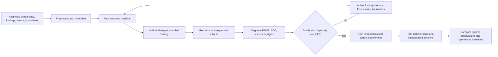
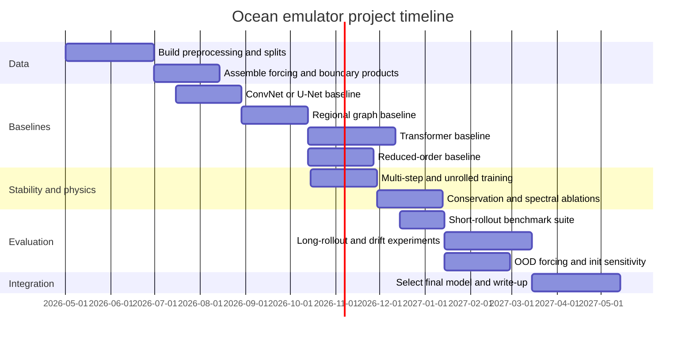

# ML Emulators for Forced Ocean Model Rollouts

## Executive summary

The literature on direct, autoregressive ocean emulation has moved well beyond toy systems, but it is still materially less mature than the analogous atmosphere literature. The strongest ocean-only end-to-end emulators I found are **Samudra** for full-depth climate-scale emulation, **WenHai**, **XiHe**, and **FuXi-Ocean** for global upper-ocean forecasting, **SeaCast** for limited-area forecasting with explicit lateral boundaries, **ORCA-DL** for seasonal-to-decadal prediction, **OceanNet** and related Fourier-neural-operator systems for regional operator learning, and a new entity["organization","NOAA","US ocean and weather agency"]-trained GraphCast-style ocean emulator that studies correlation-aware losses on UFS-Replay. The atmosphere literature is already broader and deeper: **GraphCast**, **Pangu-Weather**, **FourCastNet**, **FuXi**, **FuXi-S2S**, **NeuralGCM**, **ACE/ACE2**, **DLESyM**, and **Ola** collectively provide a mature set of transferable design patterns for rollouts, forcing handling, stability control, and long-horizon evaluation. citeturn15view5turn10view1turn29view0turn31view1turn10view3turn15view0turn18view0turn28view0turn26view0turn10view8turn10view9turn10view10turn10view11turn10view12turn25view1turn25view4turn10view6

For your stated target—**an emulator that rolls out the full forced ocean state rather than a learned parameterisation embedded inside a Navier–Stokes solver**—the key architectural lesson is that no single backbone currently dominates every regime. Convolutional U-Nets remain strong for coarse-to-moderate resolution climate emulation; graph networks are especially attractive for regional domains with irregular coastlines and open boundaries; transformer families currently dominate upper-ocean, global, medium-range forecasting; operator-learning methods are very competitive regionally and in coastal settings; and reduced-order or latent-space surrogates are the clearest route to long horizons at modest compute. Hybrid ML–physics and PINN-style approaches are important conceptually, but in the ocean literature they still sit mostly adjacent to, rather than at the centre of, full forced 3D ocean emulation. citeturn16view0turn13view7turn13view8turn29view0turn31view1turn19view0turn19view1turn23view0turn21search2turn10view10turn9search14turn21search19

The literature also points to a sharp distinction between **forecast skill** and **scientific usability**. Several models achieve excellent RMSE or ACC at short lead times, but comparatively fewer convincingly address external forcing shifts, conservation, coupled feedbacks, operational initialisation, or long-term drift. The most important open problems are: realistic treatment of surface and lateral forcing; explicit handling of tides, rivers, and sea-ice/ocean/atmosphere coupling; stable long rollouts under changed climate forcing; and tighter integration with data assimilation. These are not peripheral issues: in the ocean they are often the difference between an impressive benchmark and an actually useful emulator. citeturn13view4turn13view8turn16view1turn13view7turn23view0turn25view3turn28view2

My practical recommendation is a staged programme rather than a “moonshot first” build. Start with a **regional boundary-aware emulator** where forcing and lateral boundaries are explicit; then build a **global upper-ocean medium-range emulator** with prescribed atmospheric forcing; only then move to a **full-depth climate-scale emulator**. This mirrors the technical progression in the literature and is the most defensible way to de-risk boundary handling, stability, and evaluation before tackling truly coupled or multi-decadal problems. citeturn10view3turn10view1turn15view0turn15view5

## What the literature now supports

Ocean emulation is harder than atmospheric emulation for reasons that are structural, not incidental. Oceans evolve on longer intrinsic timescales, possess strong vertical stratification and bathymetric control, are interrupted by coastlines and straits, and inherit forcing from the atmosphere through stresses and fluxes that may themselves respond to ocean state. Adam Subel and Laure Zanna’s conceptual study on “building ocean climate emulators” makes precisely this point: the role of the atmosphere and the representation of variables with distinct timescales are central design choices, not implementation details. The companion “challenge of land” paper shows that coastlines and land masks are not cosmetic preprocessing issues either; they can move errors substantially, especially near boundaries. citeturn10view5turn13view9turn28view1

That framing helps explain the present literature split. One branch aims at **global medium-range forecasting** using reanalyses or replay datasets, often for the upper 600–1500 m and at daily or 6-hourly cadence. This branch includes XiHe, WenHai, FuXi-Ocean, and the 2026 GraphCast-derived ocean emulator. Another branch aims at **regional forecasting** where irregular coastlines and open boundaries dominate the design, represented by SeaCast, OceanNet, regional FNO studies, and coastal neural-operator or reduced-order surrogates. A third branch aims at **climate-scale emulation**, where the main questions are long-term stability, drift, and response to forcing. Samudra, ORCA-DL, and the atmospheric climate-emulator literature are the main references here. citeturn29view0turn10view1turn31view1turn28view2turn10view3turn18view0turn18view1turn23view0turn15view5turn15view0turn25view1turn25view4

A striking pattern is that the ocean literature frequently borrows directly from atmospheric emulator design. **GraphCast** from entity["organization","Google DeepMind","AI research lab"] established a highly successful graph-mesh autoregressive weather backbone trained on ERA5. **Pangu-Weather** demonstrated a 3D Earth-specific transformer with hierarchical temporal aggregation. **FourCastNet** showed the value of spectral/operator backbones and multi-step objectives. **NeuralGCM** demonstrated that differentiable physical cores plus learned components can extend useful training beyond one-step prediction. **ACE/ACE2** from entity["organization","Allen Institute for AI","research institute"] pushed long-term atmospheric emulation, explicit forcing inputs, and hard mass/moisture constraints. Ocean papers now reuse these motifs: graph meshes for regional domains, transformer blocks for global forecasting, spectral regularisers to prevent small-scale collapse, and multi-step or correlation-aware losses to tame error accumulation. citeturn26view0turn10view8turn10view9turn13view0turn25view1turn25view3turn13view7turn19view1turn28view0

The current best interpretation is therefore not that there is already a settled “ocean GraphCast”. Rather, there is a rapidly growing design space in which the best architecture depends strongly on the forecast horizon, the domain geometry, the vertical depth represented, the forcing interface, and how much physical structure you need to preserve. citeturn10view5turn28view2turn23view0

## Architectures and implementations

The table below compares the main **ocean-side implementations** most relevant to your brief.

| Model | Problem class | Core architecture | Inputs and outputs | Forcings and boundaries | Rollout and stability choices | Status and code |
|---|---|---|---|---|---|---|
| **Samudra** | Full-depth global climate emulator | ConvNeXt U-Net | Full-depth sea-surface height, velocities, temperature, salinity; stacked as variable×depth channels; 2-input/2-output recurrent setup. citeturn16view0turn16view2 | Prescribed atmospheric boundary conditions; long control runs use repeated 1990–2000 forcing with near-zero globally integrated heat flux to minimise drift. citeturn15view5 | Multi-step recurrent MSE; century-to-400-year stable rollouts; stable but weak response under imposed climate-change heat forcing. citeturn15view5turn16view1 | Peer-reviewed (**GRL 2025**) with official repository and weights. citeturn11view0turn9search18 |
| **SeaCast** | Regional medium-range forecast in the entity["place","Mediterranean Sea","european inland sea"] | Hierarchical graph neural network | Sea state on native grid plus atmospheric forcing, encoded to a hierarchical mesh; predicts one-day tendencies. citeturn10view3turn13view8 | 10 m wind stress, 2 m temperature, MSLP, day-of-year; open boundaries overwritten using truth during training and MedFS during evaluation. citeturn13view7turn13view8 | Autoregressive encode–process–decode cycling; tendency prediction; boundary overwriting; 15-day forecasts with persisted boundary conditions. citeturn10view3turn13view7 | Peer-reviewed (**Scientific Reports 2025**) with official repository. citeturn10view3turn11view1 |
| **WenHai** | Global eddy-resolving upper-ocean forecast to 643 m | Transformer-style DNN with flux block | Ocean variables plus atmospheric variables; predicts daily ocean tendencies. citeturn13view4 | Bulk formulae convert atmosphere and ocean surface variables into momentum, heat, and freshwater fluxes, including wind stress, latent/sensible heat, longwave radiation, evaporation, precipitation. citeturn13view4turn13view5 | Daily tendency prediction added to state; iterative rollout; loss weighted more strongly near the surface to preserve mesoscale eddies. citeturn13view4 | Peer-reviewed (**Nature Communications 2025**) with official repository. citeturn10view1turn11view2 |
| **XiHe** | Global upper-ocean 1–10 day forecast to 643 m | Hierarchical ocean-specific transformer | SST, SSH, 23-layer temperature/salinity/u/v, plus 10 m winds; predicts multiday ocean states. citeturn29view0 | Explicit sea-surface wind forcing; ocean–land masking mechanism to reduce irrelevant land influence and cost. citeturn29view0 | Separate models for different lead times; slower error growth than operational GOFS baselines reported by authors. citeturn29view0 | Preprint with official repository and ONNX weights. citeturn29view2turn11view3 |
| **FuXi-Ocean** | Global sub-daily eddy-resolving forecast to 1500 m | Attention model with Mixture-of-Time | High-resolution global ocean state; predicts 6-hourly temperature, salinity, and currents across depth. citeturn31view1turn31view2 | Designed to address cumulative errors across temporal contexts; public abstract does not yet expose detailed forcing interface in the surveyed sources. citeturn31view1 | Mixture-of-Time module adaptively combines multiple temporal contexts to reduce sequential error growth. citeturn31view1 | NeurIPS/OpenReview-era paper; I did not find an official code release in the surveyed sources. citeturn30search5turn31view1 |
| **ORCA-DL** | Global seasonal-to-decadal prediction | Multi-encoder fusion model with time-rotary fusion | Initial ocean state (upper 1000 m) plus wind stress; month-by-month prediction of temperature, salinity, currents, and related fields. citeturn15view0turn16view7turn16view9 | Uses only zonal and meridional wind stress as forcing in the published system; coastlines included as boundary conditions. citeturn15view0turn16view7 | Autoregressive month stepping; lead time fed into the model; 10-member ensemble; reported smaller climate drift than comparison dynamical models. citeturn15view0turn16view8turn16view9 | Peer-reviewed (**Science Advances 2025**) with official repository. citeturn11view4turn6search3 |
| **OceanNet** | Regional SSH emulation in the entity["place","Gulf Stream","north atlantic current"] / northwest Atlantic | Fourier Neural Operator | Historical SSH only in the published version. citeturn18view0turn19view3 | No explicit atmosphere or river/tide interface in the published core model; trained on data-assimilative regional reanalysis. citeturn19view3 | Predictor–evaluate–corrector integration, spectral regulariser, two-time-step loss; stable to at least 120 days. citeturn19view0turn19view1turn19view2 | Peer-reviewed (**Scientific Reports 2024**); no official public code located in surveyed sources. citeturn18view0 |
| **Reduced-order coastal surrogates** | Forced coastal/ocean shallow-water dynamics | POD+LR/MLP/GRU and Koopman autoencoders | 2D surface elevation and depth-averaged currents on flexible meshes. citeturn23view0 | Explicit meteorological and boundary forcing, encoded separately from state. citeturn23view0 | Temporal unrolling and eigenvalue regularisation materially improve stability; 4-month to 1-year autoregressive horizons. citeturn23view0 | 2026 preprint; code not public at the time of the paper owing to IP constraints. citeturn23view0 |
| **GraphCast-derived ocean emulator** | Global medium-range ocean forecast | GraphCast-style graph model | UFS-Replay ocean state with prescribed atmospheric conditions; 24 h step. citeturn28view0turn28view2 | Prescribed atmospheric forcing from UFS-Replay; emphasis is on target correlation structure rather than explicit boundary machinery. citeturn28view0turn28view2 | Not trained autoregressively; Mahalanobis loss improves physical realism and forecast skill and functions as a statistical-dynamical regulariser. citeturn28view0turn28view2 | 2026 preprint; no official code located in surveyed sources. citeturn28view0 |

A second pattern emerges if one groups the literature by **architecture family** instead of by named model.

| Architecture family | Typical inputs and outputs | Typical losses | Data needs | Forcing and boundary handling | Rollout strategy | Representative ocean papers | Closest atmospheric analogues |
|---|---|---|---|---|---|---|---|
| **Convolutional 2D/“2D over stacked depth” U-Nets and CNNs** | 2D maps with channels representing variable×depth, masks, and sometimes forcings; outputs are next state or tendency. | Usually MSE/MAE on normalised fields; sometimes multi-step recurrent losses. | Large, gridded, consistently remapped training sets; parent-model output is common. | Land–sea masks, periodic/zero padding, stacked surface forcing channels. | Teacher forcing for one-step training, then autoregressive rollout. | Samudra; the land-boundary CNN study on MITgcm channels. citeturn16view0turn15view5turn28view1 | Early CNN weather models and many climate-emulator baselines; in current frontier atmospheric work this family is less dominant than graphs or transformers. citeturn25view3 |
| **Graph neural networks** | State and forcing projected to graph nodes/edges on irregular or multi-scale meshes; outputs usually tendencies. | RMSE/MSE on node fields, sometimes multi-step training. | Works well when coastlines or stretched/irregular grids matter. | Natural fit for open boundaries and regional masks; easy to overwrite or inject boundary states. | Strong for autoregressive medium-range forecasts. | SeaCast; GraphCast-derived global ocean work. citeturn10view3turn13view7turn28view2 | GraphCast; Neural-LAM. citeturn26view0turn11view10 |
| **Transformers and spatio-temporal attention models** | Patchified state tensors, often with atmosphere channels; outputs can be direct future states or tendencies. | MSE dominates; weighting by depth/level is common; some systems train separate lead-time heads or multi-lead cascades. | Very data-hungry; high-resolution replay/reanalysis is usually required. | Patches and masks handle land; atmosphere can enter as raw fields or via learned contexts/auxiliary flux blocks. | Either separate lead-time models, cascades, or autoregressive iteration. | XiHe, WenHai, FuXi-Ocean. citeturn29view0turn13view4turn31view1 | Pangu-Weather, FuXi, FuXi-S2S. citeturn10view8turn10view11turn10view12 |
| **Recurrent models including LSTM/ConvLSTM** | Often latent coefficients or surface maps over short windows; outputs one or several future steps. | MSE/RMSE on coefficients or maps. | Less data-hungry than large transformers, but usually lower ceiling on very high-dimensional global problems. | Usually implicit rather than explicit; often used in reduced-order or surface-only settings. | Naturally autoregressive. | POD-LSTM for two-layer QG; ConvLSTM variants for SST and wave forecasting. These are important adjacent references, but not yet the centre of full forced 3D OGCM emulation. citeturn23view1turn5search7turn5search14 | Still used in some regional or baseline atmospheric work, but largely displaced in frontier global forecasting. citeturn10view11 |
| **Operator learning, including FNO and latent/operator hybrids** | Field-to-field map over one or several timesteps; often SSH, currents, or shallow-water state. | MSE plus spectral penalties or multistep losses. | Can be very efficient when geometry is regular enough or when latent-space operators are used. | Periodicity is natural; non-periodic boundaries need special care or are learned imperfectly. | One-step operator with explicit autoregressive rollout; multistep loss stabilises. | OceanNet; regional FNO studies; MITONet. citeturn19view0turn19view1turn18view1turn21search2 | FourCastNet; ACE/ACE2 SFNO. citeturn10view9turn25view3 |
| **Reduced-order models using POD, autoencoders, Koopman ideas** | Encoded state plus encoded forcings; outputs latent update, then decoded fields. | Reconstruction loss + one-step forecast loss; sometimes eigenvalue penalties or unrolled trajectory losses. | Attractive when training data or compute are limited and horizons are long. | Separate forcing encoders make boundary and meteorological inputs explicit. | Particularly good for very long autoregressive horizons. | Forced flexible-mesh coastal surrogates; POD-LSTM 2QG. citeturn23view0turn23view1 | Latent atmospheric/climate emulators are increasing, but the ocean literature presently has some of the clearest reduced-order long-horizon examples. citeturn24search0turn25view1 |
| **Hybrid ML–physics and PINN-style methods** | Either emulator + physical solver, or neural corrections constrained by PDEs. | Data loss plus physical/budget/PDE penalties. | Usually more expensive and less turnkey, but promising for conservation and robustness. | Excellent in principle for budget closure and coupling; in practice still sparse for full ocean emulators. | Can reduce drift if the physical core is strong. | Coastal PINN/physics-informed DA and shallow-water operator work exist, but not yet as mature full forced 3D ocean emulators. citeturn9search14turn21search19 | NeuralGCM, ACE2-SOM, DLESyM, conservation-scheme work on AI weather models. citeturn10view10turn24search2turn25view4turn30search14 |

The architectural conclusion is therefore pragmatic. If your first objective is **global, upper-ocean, medium-range skill**, transformers and graph-derived models currently have the strongest evidence. If your first objective is **full-depth long-horizon climate rollouts**, a convolutional U-Net or a reduced-order latent surrogate is the more conservative choice. If your first objective is **regional skill with complex boundaries**, a graph model is the most natural baseline. citeturn15view5turn29view0turn10view3turn23view0

## Forcings, boundaries, initialisation, and physical fidelity

The forcing interface is where ocean emulation either becomes physically credible or quietly fails. The literature spans three main strategies. The simplest is **direct prescribed forcing input**, often wind stress only: ORCA-DL uses just zonal and meridional wind stress, encoded together with the ocean state and lead time. XiHe also uses near-surface winds alongside ocean variables. The second strategy is **richer atmosphere-to-ocean translation inside the network**: WenHai computes bulk-formula momentum, heat, and freshwater fluxes inside the model, explicitly producing stress, heat-flux, evaporation, radiation, and precipitation-related fields before forecasting ocean tendencies. The third strategy is **coupling or pseudo-coupling**: SeaCast drives the ocean with atmospheric products such as AIFS or ENS, while coupled Earth-system efforts such as Ola, ACE2-SOM, and DLESyM move toward learned ocean–atmosphere interaction rather than purely prescribed forcing. citeturn16view7turn16view9turn29view0turn13view4turn13view5turn13view7turn13view8turn10view6turn24search2turn25view4

**Open boundaries** are treated much more explicitly in regional than in global systems. SeaCast is the clearest published example: it overwrites the predicted boundary region with the true state during training and with operational MedFS fields during evaluation. That is scientifically sensible for a bounded regional system, but it also means the emulator’s interior skill is partly conditioned on an external numerical model. The reduced-order coastal surrogate paper takes a more generic approach, explicitly encoding meteorological and boundary forcings for forced flexible-mesh systems. In contrast, many global emulators avoid the problem by working on nearly global domains. For your project, that implies a simple but important design choice: if you work regionally, boundaries must be elevated to a **first-class modelling object**, not left for “preprocessing”. citeturn13view7turn13view8turn23view0

**Land and coasts** are also central. XiHe introduces an ocean–land masking mechanism inside the transformer blocks. The MITgcm/CNN land study uses multiple static land–sea masks so that the network can distinguish different staggered-grid variable locations and treats C-grid inconsistencies explicitly before training. Samudra uses periodic padding in longitude and zero-padding at the poles. These choices look mundane, but they are exactly the mechanisms by which a model avoids inventing through-coastline transport or corrupting near-shore eddy dynamics. citeturn29view0turn28view1turn16view0

**Tides, rivers, and wave/ice coupling** are still under-served in full ocean emulators. SeaCast’s analysis fine-tuning data inherit tidal forcing and wave coupling through the underlying analysis system, but tidal dynamics are not yet exposed as an explicit emulator input in the published configuration. Tide-driven coastal neural emulators such as MITONet and the new reduced-order coastal surrogates show that forced shallow-water systems with explicit boundary control are feasible. By contrast, the global ocean-only papers surveyed here rarely treat river discharge or astronomical tidal constituents as first-class forcing inputs. I would therefore characterise explicit tides and rivers as a genuine open gap in the state of the art, not a solved engineering detail. citeturn13view7turn21search2turn23view0

**Initialisation and data assimilation** are similarly uneven. Most successful ocean emulators sidestep full learned DA by training on reanalyses or replay systems that already assimilate observations. ORCA-DL is initialised from GODAS in the official repository and is trained/evaluated against reanalysis-derived products. SeaCast reports gains from fine-tuning on analysis data, partly because the target system itself has evolved and includes better boundaries and coupling. OceanNet is trained on a data-assimilative regional reanalysis. The new GraphCast-style ocean paper explicitly argues that correlation-aware forecasts could provide better backgrounds for downstream data assimilation. What is largely missing is an end-to-end, published, widely available **ocean emulator + learned analysis update** stack comparable to operational DA pipelines. In other words, today’s best practice is still “use a good analysis to initialise the emulator”, not “learn the full initialise–rollout cycle”. citeturn11view4turn10view3turn13view7turn18view0turn19view3turn28view0turn28view2

**Conservation constraints** are more advanced in the atmosphere literature than in the direct ocean-emulator literature. ACE already emphasised that its formulation allowed evaluation of physical laws such as conservation of mass and moisture, and ACE2 later introduced hard physical constraints, exactly conserving global dry-air mass and moisture. NeuralGCM bakes a learned model into a dynamical core and trains through long simulations, which is another route to improved physical consistency. The weather literature has also begun to test modular conservation schemes directly on AI forecast models such as FuXi. In ocean-only end-to-end emulators, however, the dominant published solutions are still softer: tendency prediction, spectral regularisation, correlation-aware losses, and long control-run evaluation. That is useful, but it is not the same as hard conservation. This is one of the clearest opportunities for originality in a new ocean emulator project. citeturn24search0turn25view1turn25view3turn13view0turn10view10turn30search14turn19view1turn28view0

**Stability and drift control** are another area where the literature now offers a concrete toolbox. OceanNet uses a predictor–evaluate–corrector integrator, a spectral regulariser, and a two-time-step loss. SeaCast predicts tendencies rather than full future states and explicitly resets boundary regions. The new correlation-aware GraphCast-style ocean work replaces pure MSE with a Mahalanobis loss that better respects cross-variable covariances. The reduced-order coastal work shows that eigenvalue regularisation and temporal unrolling both matter in practice. Samudra demonstrates the value of long control runs under repeated low-net-flux forcing, but also exposes a critical warning: a model can be stable for centuries and still respond too weakly to changed climate forcing. That tension—**stability versus physically correct forced response**—is arguably the central unresolved problem for long-horizon ocean emulation. citeturn19view0turn19view1turn13view7turn28view0turn23view0turn16view1turn15view5

## Datasets, metrics, and benchmarking

A credible ocean-emulator project needs more than one dataset. You need a **training source**, an **initialisation source**, and an **evaluation source** that is at least partly independent of the training target. The most useful datasets and data products from the current literature are summarised below.

| Dataset or product | What it contains | Best use in an emulator project | Strengths | Caveats | Sources |
|---|---|---|---|---|---|
| **OM4 / parent-model climate output used by Samudra** | Full-depth SSH, velocities, temperature, salinity with prescribed atmospheric forcing. | Full-depth climate-scale emulation and long-drift experiments. | Clean parent-model target; consistent forcing/state interface; official code/weights available through the Samudra ecosystem. | Less representative of observation-driven operational work; forced-response generalisation remains difficult. | citeturn11view0turn15view5turn9search18 |
| **GLORYS12 + OSTIA + ERA5** from entity["organization","Copernicus Marine Service","EU marine data service"] / entity["organization","ECMWF","european weather centre"] | Global upper-ocean reanalysis plus SST and atmospheric winds/forcings. | Global upper-ocean daily forecasting. | High-resolution, operationally relevant, already used by XiHe and related models. | Reanalysis inherits assimilation-system biases and design choices. | citeturn29view0turn29view2 |
| **UFS-Replay** | Replay dataset with prescribed atmospheric conditions and ocean states. | Global medium-range ocean emulation with weather-style architectures. | Consistent with modern forecast-system workflows; used in the correlation-aware GraphCast adaptation. | Still emerging in the published ocean-emulator literature. | citeturn28view0turn28view2 |
| **GODAS / ORAS5 / SODA / CMIP6 historical simulations** | Long ocean reanalyses and model simulations. | Seasonal-to-decadal prediction and transfer-learning regimes. | Longer time coverage than high-resolution operational reanalyses; ORCA-DL demonstrates their utility. | Monthly cadence and model bias make medium-range forecasting harder; CMIP targets are not “truth”. | citeturn15view0 |
| **MedFS / CMEMS regional analyses plus AIFS or ENS forcing** | Regional Mediterranean ocean analyses plus atmospheric forecast products. | Boundary-aware regional forecasting and ablation studies. | Excellent for explicit study of lateral boundaries and atmosphere sensitivity. | Boundary dependence can make “apples-to-apples” comparisons subtle. | citeturn13view7turn13view8 |
| **HYCOM / ROMS data-assimilative regional runs** | Regional surface circulation and SSH datasets, often with observational assimilation. | Regional operator-learning and reduced-order baselines. | Good for fast prototyping and observation-linked validation. | Domain-specific; may not transfer well to truly global systems. | citeturn18view1turn18view0 |
| **OceanForecastBench** | ML-ready benchmark collection for medium-range global ocean forecasting. | Reproducible cross-model benchmarking. | Explicitly designed for deep-learning-ready training/evaluation. | Benchmark maturity is still newer than in atmospheric weather. | citeturn8search4 |
| **ARCO-OCEAN** | Ocean, waves, sea ice, hydrological and atmospheric forcing, optimised for ML pipelines. | Unified data engineering, especially for multi-component projects. | Strong candidate for reproducible preprocessing and multimodal forcing pipelines. | Benchmark conventions around it are still developing. | citeturn7search15 |
| **ERA5 / WeatherBench2** | Global atmospheric reanalysis and standardised weather benchmarking framework. | Atmospheric baselines, forcing products, and evaluation-method transfer. | The atmospheric emulator literature is much better standardised here. | Not an ocean target dataset by itself. | citeturn11view6turn10view10 |

Evaluation should be **multi-layered**, because no single score distinguishes a useful emulator from a fragile one. The literature still relies heavily on RMSE and ACC, and those should stay in the protocol. SeaCast, XiHe, ORCA-DL, and the main atmospheric models all report variants of RMSE/ACC. But ocean emulators also need **spectral and structural metrics**. OceanNet explicitly regularises the Fourier spectrum to combat spectral bias. The 2026 weather scaling-law paper shows again that optimising purely for MSE can blur small scales relative to spectral objectives. For reduced-order systems, kinetic energy and enstrophy remain valuable because they expose dynamical degradation before it is obvious in pixel-space RMSE. citeturn13view8turn29view0turn15view0turn19view1turn27view1turn23view1

For ocean work specifically, I recommend seven evaluation layers. First, **one-step forecast error** on normalised fields. Second, **lead-time curves** out to the full forecast horizon. Third, **spectral error or power-spectrum comparisons** for SSH, SST, and velocity to check eddy retention. Fourth, **integral metrics** such as basin heat content, steric height, kinetic energy, and where feasible volume or freshwater transports through key sections. Fifth, **object or event metrics**, for example marine heatwaves or current jets; ORCA-DL’s marine-heatwave evaluation is useful here. Sixth, **observation-facing verification**, using independent SST/SLA and in-situ profiles as SeaCast and OceanNet do. Seventh, for climate-oriented systems, **long control and perturbed-forcing runs** measuring drift, bias growth, and response sensitivity over years to centuries. citeturn15view0turn10view3turn18view0turn15view5turn16view1

A final benchmarking point matters a great deal: **keep the forcing interface fixed across competing models**. In ocean emulation, differences in boundary forcing, atmospheric products, or initial analysis can easily dominate differences in architecture. SeaCast’s own paper is unusually transparent here, and that transparency should become standard. citeturn13view7turn13view8

## Research roadmap

The most robust build path is a staged programme with explicit benchmarks, not a single end-point model. I would structure the project around three progressively harder targets: a **regional boundary-aware emulator**, a **global upper-ocean medium-range emulator**, and a **full-depth climate emulator**. This sequence mirrors the literature’s natural progression and gives you interpretable failure modes at each stage. The regional stage de-risks lateral boundaries, mask handling, and forcing ablations; the global upper-ocean stage tests whether the architecture can hold mesoscale structure under realistic atmospheric forcing; the full-depth stage is where drift, conservation, forced response, and long-memory dynamics become decisive. citeturn10view3turn10view1turn29view0turn15view5turn23view0

For **preprocessing**, adopt a deliberately conservative pipeline. Put all variables onto a common grid or mesh; handle staggered C-grid velocities explicitly rather than hiding them inside interpolation; store masks as actual input features; align forcing timestamps precisely; and maintain chronological train/validation/test splits rather than random splits. SeaCast’s three-step atmosphere windowing, WenHai’s interpolation of surface atmospheric variables before flux calculation, the land-focused MITgcm study’s explicit staggered-grid handling, and the GraphCast repository’s clear separation of preprocessing and autoregressive wrappers are the right precedents here. citeturn13view8turn13view4turn28view1turn11view6

For **baseline models**, I would not start with the most novel design. Implement four baselines in sequence: a ConvNeXt/U-Net baseline in the Samudra style; a regional graph model in the SeaCast style; a transformer baseline for global upper-ocean work in the XiHe/WenHai/FuXi-Ocean design space; and a reduced-order latent surrogate, preferably POD-GRU and Koopman-autoencoder variants, for long-horizon stress-testing. That set is wide enough to identify whether your problem is limited by geometry, scale separation, or forcing representation rather than by some arbitrary backbone choice. citeturn16view0turn10view3turn29view0turn13view4turn23view0

For **physics and stability enhancements**, treat them as ablations rather than default complexity. The atmospheric literature suggests that multi-step losses, spectral objectives, conservation penalties, and post-training autoregressive “cooldown” phases can all help, but they should be tested separately. Likewise, the ocean literature suggests that tendency prediction, PEC integration, Mahalanobis losses, eigenvalue regularisation, and temporal unrolling can all improve long rollouts. The right question is not “which trick is best in general?” but “which trick helps *this* domain and forcing interface without destroying generalisation?”. citeturn19view1turn28view0turn23view0turn27view1turn25view3turn30search14

The workflow below synthesises the training–rollout–evaluation loop implied by the best current papers.

The experiment matrix below is the minimum I would regard as publishable for a first serious ocean-emulator paper.

| Experiment | Why it matters | Variants to include | Main metrics | Literature anchor |
|---|---|---|---|---|
| **One-step prediction** | Establishes whether the backbone can represent local dynamics at all. | State vs tendency target; with and without forcing channels. | RMSE, MAE, correlation. | WenHai, SeaCast, Samudra. citeturn13view4turn13view7turn15view5 |
| **Short autoregressive rollout** | Tests whether one-step skill survives accumulation. | 10–15 day regional/global; 1 day and 6 h steps if available. | Lead-time RMSE/ACC; spectra; visual eddy retention. | SeaCast, XiHe, WenHai, FuXi-Ocean. citeturn10view3turn29view0turn10view1turn31view1 |
| **Boundary sensitivity** | Essential for any regional system. | Boundary overwrite, persisted boundaries, learned boundary encoder, perturbed boundaries. | Interior RMSE by distance from boundary; transport metrics. | SeaCast; coastal ROM surrogates. citeturn13view7turn23view0 |
| **Forcing ablation** | Identifies whether the model is using the right physics. | Remove wind stress, heat flux proxies, MSLP, seasonal features, river/tide controls if present. | Skill degradation by variable and depth. | SeaCast; WenHai. citeturn13view8turn13view4 |
| **Initialisation / DA sensitivity** | Separates forecast skill from analysis dependence. | Analysis vs reanalysis vs degraded initial states; optional learned initialiser. | Error as a function of initial-state quality. | ORCA-DL repo; SeaCast fine-tuning; OceanNet. citeturn11view4turn13view7turn19view3 |
| **Long control rollout** | Measures drift and hidden instability. | 3–12 month for forecast systems; 100-year style control for climate systems. | Mean drift, variance drift, spectrum collapse, integral budgets. | Samudra, OceanNet, ACE, DLESyM. citeturn15view5turn19view2turn24search0turn25view4 |
| **Changed-forcing generalisation** | The central unsolved climate-emulation problem. | Historical vs unseen years; perturbed heat or wind forcing; CO2-aware or cumulative-forcing channels if available. | Trend fidelity, regional response patterns, drift under forcing. | Samudra, ACE2, ACE2-SOM. citeturn16view1turn25view1turn24search2 |
| **Conservation and physical consistency** | Needed for scientific trust, not just benchmark scores. | No penalty vs budget penalties vs post-processing constraints. | Global/basin mass, freshwater, heat-content consistency; transports. | ACE, ACE2, NeuralGCM, conservation-scheme work. citeturn24search0turn25view1turn10view10turn30search14 |

The timeline below is a reasonable eighteen-month research plan for a small academic team or focused industrial R&D effort.

The **compute budget** should be sized to the stage of the project, not to the most ambitious paper in the field. As an anchor, Samudra reports training on 4×80 GB A100 GPUs for roughly 12–15 hours for its 5-day climate-emulator configuration, while the official Pangu repository reports roughly 3,000 V100 GPU-days for each full weather model, with a much cheaper “lite” version using less than 1% of that resource. WenHai explicitly needed distributed model partitioning because high-resolution transformer training exceeded 80 GB device memory in its second stage. My recommendation is therefore to begin with a budget small enough to let you run many ablations: for example, a regional graph or U-Net model on 1–4 A100s, then scale only after the forcing interface and evaluation protocol have stabilised. That is an inference from the cited training anchors, but it is the safest one. citeturn15view5turn12view0turn13view6

The main **risks** are not generic “overfitting” risks. They are domain-specific:

| Risk | Why it is serious | Mitigation |
|---|---|---|
| **Boundary leakage** | Regional skill can be artificially inflated if boundary conditions come from the same system you compare against. | Report boundary source transparently; evaluate by distance from boundary; test degraded or alternative boundary products. citeturn13view7 |
| **Forcing mismatch** | Ocean response is highly sensitive to the exact representation of stress and surface fluxes. | Compare raw-forcing, flux-block, and mixed interfaces; do forcing ablations. citeturn13view4turn13view8 |
| **Spectral smoothing** | Good RMSE can coexist with poor eddy spectra and underpowered extremes. | Add spectral diagnostics and, if necessary, spectral regularisers or post-training losses. citeturn19view1turn27view1 |
| **Stable but wrong climate response** | Long-horizon stability is not enough if forced trends are wrong. | Include perturbed-forcing tests early; do not wait until the end of the project. citeturn16view1 |
| **Analysis dependence** | Apparent skill may come from excellent initial analyses rather than a robust dynamics model. | Include degraded-initial-state and cross-analysis tests. citeturn11view4turn13view7 |
| **Weak physical credibility** | Without budget checks, the emulator may be hard to trust scientifically. | Add conservation diagnostics and transport/integral metrics from the beginning. citeturn25view1turn30search14 |

If I had to reduce the whole survey to a single actionable recommendation, it would be this: **build the forcing and boundary interface first, and treat architecture second**. The published evidence suggests that many backbones can work if the interface is sound, but even strong backbones become brittle when forcing, masks, boundaries, or initialisation are underspecified. For an ocean emulator intended to replicate a full forced model, that is the highest-leverage design principle in the literature. citeturn10view5turn13view7turn13view8turn16view1turn23view0